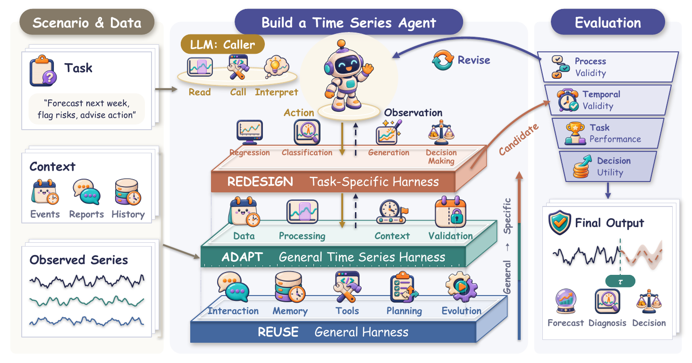
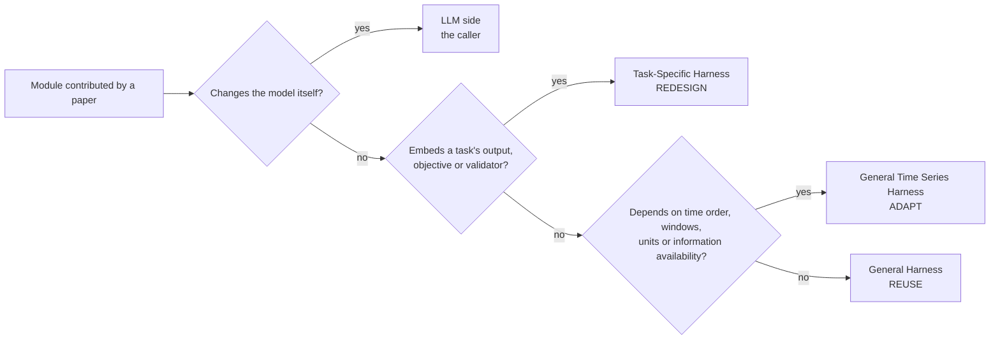
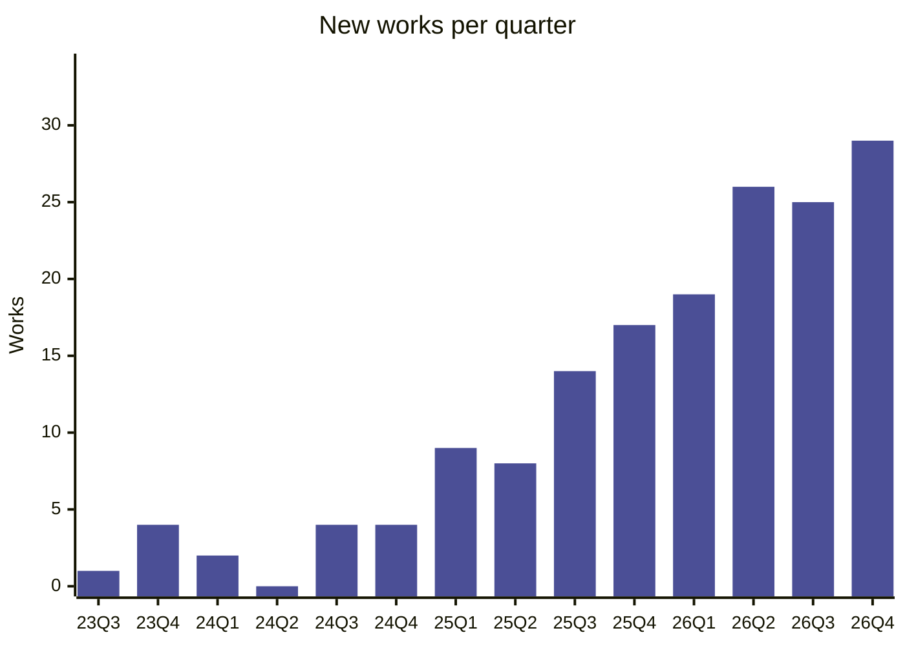
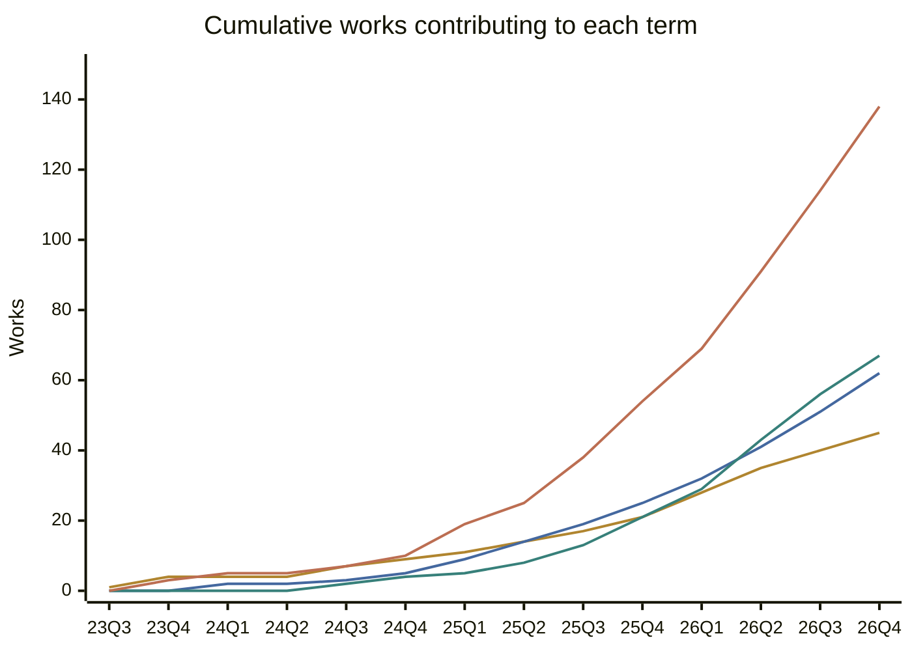

<h1 align="center">Time Series Agents: A Survey of LLMs, Harness Architectures, and Evaluation</h1>

<p align="center">
  <a href="paper/Time-Series-Agents-Survey.pdf"></a>
  
  
  
  <a href="skills/time-series-agents/SKILL.md"></a>
  
</p>

<p align="center">
  <a href="#-the-survey">Survey</a> ·
  <a href="#-use-it-with-your-coding-agent">Agent skill</a> ·
  <a href="#-how-a-time-series-agent-is-built">Formula</a> ·
  <a href="#-what-the-paper-cards-show">Findings</a> ·
  <a href="#-paper-list">Paper list</a> ·
  <a href="#-evaluation-and-open-problems">Open problems</a> ·
  <a href="#%EF%B8%8F-paper-cards">Paper Cards</a> ·
  <a href="#-star-history">Star history</a>
</p>

<p align="center">
  
</p>

A curated, machine-readable map of LLM-based Time Series Agents. Every work is a **Paper Card**: its modules are
classified into the survey's formula, each with the quoted passage that supports it and links to official code and data.
Read the list below, query the cards from the command line, or install the agent skill and ask.

## 📄 The survey

> Time Series Agents run forecasting, diagnosis, and decision making as workflows in which an LLM calls tools and
> interprets their results. As research shifts from adapting the LLM to engineering the runtime around it, building
> such an Agent means deciding, module by module, what to reuse from a general Agent runtime, what needs temporal
> semantics such as information availability, and what to redesign around a task. We decompose a Time Series Agent
> into an LLM, a General Harness, and a Time Series Harness that splits into a General Time Series Harness shared
> across tasks and a Task-Specific Harness bound to one task. The LLM calls the Harness, which treats forecasting models
> as tools, and four evaluation criteria diagnose the contribution of each term.

📥 **[Read the paper (PDF)](paper/Time-Series-Agents-Survey.pdf)**

## 🤖 Use it with your coding agent

**Option 1: install the skill.** It works from any project: the skill fetches the Paper Cards on first use.

```bash
git clone --depth 1 https://github.com/PoorOtterBob/Time-Series-Agents-Survey.git
mkdir -p ~/.claude/skills && cp -r Time-Series-Agents-Survey/skills/time-series-agents ~/.claude/skills/
```

**Option 2: open the repository.** [`AGENTS.md`](AGENTS.md) points Claude Code and Codex to the same instructions.

```bash
cd Time-Series-Agents-Survey && claude      # or: codex
```

Then ask, for example:

| Goal | Ask |
|---|---|
| Find mechanisms | *"Which shared modules handle information cutoff or look-ahead leakage? Quote the evidence."* |
| Understand one paper | *"What does AION contribute at each layer, and which parts could I reuse?"* |
| Compare | *"Compare how forecasting Agents implement temporal memory. Which are task-bound?"* |
| **Design an Agent** | *"I forecast hourly electricity load and must flag anomalies for operators. Design a Time Series Agent: what to reuse, adapt and redesign, and how to evaluate it."* |
| Find resources | *"Which benchmarks test temporal validity, and where is their official code?"* |

> [!TIP]
> Without an agent, the same lookups run from the command line (Python 3, standard library only):
> `python3 scripts/query_cards.py --layer GTS --function context_memory` lists shared temporal memory modules;
> `--work aion2026` prints one card; `--stats` gives counts by layer, function, and task.

## 🧱 How a Time Series Agent is built

$$\textbf{Time Series Agent} \approx \text{LLM} + \text{General Harness} + \text{Time Series Harness}$$

$$\textbf{Time Series Harness} = \text{General Time Series Harness} + \text{Task-Specific Harness}$$

Each module a paper contributes is assigned to the **most specific** term whose condition it meets:



| Term | Vocabulary | Basis |
|---|---|---|
| **LLM side** | The caller $\pi_\theta$ | Reads the state and makes function calls; time series foundation models are tools in the Harness |
| **General Harness** | Interface and Interaction · Memory and Context · Tools and Execution · Planning and Orchestration · Optimization and Evolution | Agent and Harness research (CoALA and Agent-harness surveys) |
| **General Time Series Harness** | Temporal Data Management · Temporal Processing · Temporal Context and Memory · Temporal Validation | The availability record $(x_i,t_i,v_i)$, after valid and transaction time in temporal databases: store it, operate on it over windows, admit outside context, check $v_i\le\tau$ |
| **Task-Specific Harness** | Task grid: Regression · Classification · Generation · Decision Making, each on the observed record or after the current time | Output type and its scoring rule × the classical split at the current time; standard task names in each cell |
| **Evaluation** | Process Validity · Temporal Validity · Task Performance · Decision Utility | Four episode-level criteria that diagnose each term |

<details>
<summary><strong>Second-level classes and the task grid</strong> (paper Tables 3, 4, and 5)</summary>

| First level | Second-level classes | Criterion |
|---|---|---|
| Interface and Interaction | Reasoning loop · action interface · environment and users | Part of the Agent loop |
| Memory and Context | Working context · episodic records · knowledge retrieval · shared state | Scope and lifetime |
| Tools and Execution | Function calls · code and job execution · verification tools | Object executed |
| Planning and Orchestration | Decomposition and planning · execution control · checkpoints and governance · multi-agent coordination | Object organized |
| Optimization and Evolution | Prompt optimization · experience distillation · tool and skill evolution · Harness configuration search | Asset changed |
| Temporal Data Management | Measurement schema ($x$) · time index and alignment ($t$) · point-in-time access ($v$) · temporal workspace | Record component |
| Temporal Processing | Preprocessing and transformation · statistical and spectral analysis · series views for the LLM · operator and skill libraries | Returned object |
| Temporal Context and Memory | External events and text · historical analogues · procedural experience | Admitted information |
| Temporal Validation | Availability checks ($v$) · past-only computation ($t$) · data and schema checks ($x$) · temporal claim verification | Checked component |
| Regression | Observed: imputation and estimation (15 works) · After: value forecasting, point or probabilistic (74) | Checked against observed values |
| Classification | Observed: classification · anomaly detection · root cause identification · closed question answering (65) · After: event forecasting (14) | Checked against observed classes |
| Generation | Observed: open question answering · explanation · annotation · synthesis (40) · After: projection (0) | Quality, fidelity, and use |
| Decision Making | Observed: hindsight decision (0) · After: advisory decision · autonomous control (46) | Consequences of the action |

</details>

## 📈 What the Paper Cards show

Statistics count works: a work counts once in every term to which it contributes a module.





<sub>Lines from top at the last quarter: Task-Specific Harness (138), General Time Series Harness (67), General Harness (62), LLM side (45). Dates follow the first public version. The last quarter covers 2026-10 only.</sub>

- **Effort is moving from the model to the runtime.** The number of works contributing to each term grows
  exponentially, slowest for the LLM side (doubling every 9.3 months) and fastest for the General Time Series Harness
  (5.7 months). More than half of the works released until the end of 2024 modified the LLM; since 2025, between 17%
  and 31% per period do.
- **Most works automate an existing analysis** (84% of the 162 works), and nearly all report task performance
  (95%), but only 41% report process validity and 20% decision utility.
- **Solutions to time series requirements stay inside tasks.** Of the 71 works that test such a requirement (leakage,
  regime change, data quality, context, decision consequences, verifiability, deployment), 76% test a solution inside
  a task module and 21% one in a shared time series module. Twice as many works build task-specific modules (138) as
  shared temporal ones (67).
- **Generality is often claimed, less often shown.** Of the 97 works with shared modules, 40% demonstrate reuse in a
  second cell of the task grid.
- **Time series adaptation is mostly tools.** 82% of the works with General Time Series Harness modules use them for
  tools and execution; such modules appear in only 10% of the works that plan or orchestrate and in two works that
  optimize the Harness.
- **Two task cells are empty.** Projection (futures under assumed conditions) and hindsight decision (the action that
  should have been taken earlier) appear only inside decision procedures, never as evaluated outputs.

## 🧪 Evaluation and open problems

An Agent is evaluated over a whole episode: the contract and resources it receives, the tool calls it executes, and
the artifacts it returns. Four criteria diagnose each term: **process validity** (the runtime executed the intended
operations), **temporal validity** (the data window, units, and information boundary were respected), **task
performance** (the output is accurate), and **decision utility** (the action that follows is worth taking).

Within the reviewed works, the gap is one of evidence rather than capability. Each open problem below is stated with
the controlled comparison that would count as a solution, holding the backbone, information boundary, and resource
budget fixed.

| Open problem | Controlled comparison |
|---|---|
| Model or Harness: which temporal judgments belong in the LLM | Native temporal perception versus a Harness tool on the same questions |
| Memory under changing information | Conclusions before and after a data release revises earlier values |
| Transferring learned procedures | A learned tool or experience in a seen versus a held-out cell, domain, or regime |
| Evidence-sensitive evaluation | The same task with supporting evidence present versus removed |
| Closing the prediction-to-decision loop | Forecast error and the utility of the action it drives, scored together |
| Projection as an evaluated output | Rollouts under alternative assumptions scored against known effects |
| Hindsight decision as an evaluated output | Replaying an earlier state and scoring the change in outcome (regret) |
| Probabilistic outputs | Point forecasts versus calibrated distributions on the same decision |

## 📚 Paper list

Works are listed once, newest first, under the output mode most of their task modules serve. **Layers** shows the terms
to which a work contributes modules. **Cells** lists every cell of the task grid it addresses: Reg (regression),
Cls (classification), Gen (generation), or Dec (decision making), on the observed record (●) or after the current
time (▶). **Links** are the authors' own code, data, and project pages. Each work's key opens its full card:
`python3 scripts/query_cards.py --work <key>`.

### Time Series Agents and workflows

**Loop**: *feedback* means tool or environment feedback changes the next action; *fixed* means a predetermined sequence of model and tool calls.

<details open>
<summary><strong>Regression</strong>: imputation, estimation, and value forecasting (50 works)</summary>

| Date | Work | Venue | Loop | Layers | Cells | Links |
|---|---|---|---|---|---|---|
| 2026‑10 | **World2TS**<br><sub>[World2TS: Real-World Event Context for Time-Series Forecasting](https://arxiv.org/abs/2610.14861) · `world2ts2026`</sub> | arXiv | feedback | `GH` `GTS` | Reg▶ Gen● | [project](https://world2ts.github.io/) |
| 2026‑10 | **TimeRSI**<br><sub>[TimeRSI: Towards Self-Improved Agentic Deployment for Time-Series Foundation Models](https://arxiv.org/abs/2610.19725) · `timersi2026`</sub> | arXiv | feedback | `TSK` | Reg▶ | [code](https://github.com/haoxin1998/TimeRSI) |
| 2026‑10 | **SEER**<br><sub>[SEER: Self-Evolving Event Reasoning and Retrieval for Time Series Forecasting](https://arxiv.org/abs/2610.04109) · `seer2026`</sub> | arXiv | feedback | `TSK` | Reg▶ Cls▶ | [code](https://github.com/BennyTMT/SEER) |
| 2026‑10 | **Prompt Evolution for Forecasting**<br><sub>[Training-Free Continual Learning for Multimodal Forecasting via Prompt Evolution](https://arxiv.org/abs/2610.27468) · `promptevolutionforecast2026`</sub> | arXiv | feedback | `GTS` `TSK` | Reg▶ |  |
| 2026‑10 | **EvoCast**<br><sub>[EvoCast: Reliable Autonomous Research Agents for Iterative Forecasting Architecture Evolution](https://arxiv.org/abs/2610.04517) · `evocast2026`</sub> | arXiv | feedback | `GH` `TSK` | Reg▶ | [code](https://github.com/18e0-x/EvoCast) |
| 2026‑10 | **EpiCoach**<br><sub>[The Athlete as a Scientist of One: Agentic Bayesian Experimental Design for Individualized Physiology from Consumer Wearables](https://arxiv.org/abs/2610.40370) · `epicoach2026`</sub> | arXiv | feedback | `GTS` `TSK` | Reg▶ Dec▶ | [code](https://github.com/Bmoradi93/epicoach-agent) |
| 2026‑09 | **Can Language Models Learn to Forecast Stock Prices**<br><sub>[Can Language Models Learn to Forecast Stock Prices](https://arxiv.org/abs/2609.36914) · `auraforecaster2026`</sub> | arXiv | feedback | `LLM` `GTS` `TSK` | Reg▶ |  |
| 2026‑08 | **TraceMAS**<br><sub>[Traceable Multi-Agent System for Knowledge-Based Forecasting](https://arxiv.org/abs/2608.03339) · `tracemas2026`</sub> | arXiv | feedback | `GTS` `TSK` | Reg▶ |  |
| 2026‑08 | **SCENARIODIFF**<br><sub>[SCENARIODIFF: A Scenario-level Guidance Framework for Multimodal Time Series Forecasting--Extended Version](https://arxiv.org/abs/2608.17164) · `scenariodiff2026`</sub> | arXiv | fixed | `GTS` `TSK` | Reg▶ | [code](https://anonymous.4open.science/r/ScenarioDiff_ICDM-2C4C) |
| 2026‑08 | **ReasonCast**<br><sub>[ReasonCast: Agentic Demand Forecasting with Selective Semantic Reasoning](https://arxiv.org/abs/2608.15291) · `reasoncast2026`</sub> | arXiv | feedback | `LLM` | Reg▶ |  |
| 2026‑08 | **MetaCaster**<br><sub>[MetaCaster: Meta-Harness-Optimized Agent for End-to-End Few-Shot Learning of Lightweight Time Series Forecasters](https://arxiv.org/abs/2608.23473) · `metacaster2026`</sub> | EMNLP 2026 | feedback | `GH` `TSK` | Reg▶ Gen● | [code](https://github.com/D2I-Group/metacaster) |
| 2026‑08 | **CastFlow**<br><sub>[CastFlow: Learning Role-Specialized Agentic Workflows for Time Series Forecasting](https://arxiv.org/abs/2604.27840) · `castflow2026`</sub> | arXiv | feedback | `LLM` `GTS` `TSK` | Reg▶ | [code](https://github.com/Forever-Pan/CastFlow) |
| 2026‑08 | **CastFSR**<br><sub>[CastFSR: A Fast--Slow--Reflect Agentic Reasoning Framework for Context-Aware Time Series Forecasting](https://arxiv.org/abs/2608.03031) · `castfsr2026`</sub> | arXiv | feedback | `LLM` `TSK` | Reg▶ | [code](https://github.com/Xiaoyu-Tao/CastFSR) |
| 2026‑08 | **CRAFTER**<br><sub>[When Do Corrective Features Help? An Agent for Corrective Feature Discovery on Black-Box Forecasters](https://arxiv.org/abs/2608.05207) · `crafter2026`</sub> | arXiv | feedback | `TSK` | Reg▶ |  |
| 2026‑08 | **AQuA**<br><sub>[AQuA: Recursively Self-Improving Quantitative Trading Research Agents](https://arxiv.org/abs/2608.12841) · `aqua2026`</sub> | arXiv | feedback | `GH` `GTS` `TSK` | Reg▶ Dec▶ |  |
| 2026‑07 | **TopoBrick**<br><sub>[TopoBrick: Agentic Topology Sampling of Exogenous Variables for Zero-Shot Building IoT Forecasting](https://arxiv.org/abs/2607.06349) · `topobrick2026`</sub> | arXiv | feedback | `TSK` | Reg▶ | [code](https://github.com/Dawnlxc/TopoBrick.git) |
| 2026‑07 | **HydroAgent**<br><sub>[HydroAgent: Formalizing Forecaster Expertise into Skill-Orchestrated Flood Forecasting Workflows](https://arxiv.org/abs/2607.23983) · `hydroagent2026`</sub> | arXiv | fixed | `GH` `TSK` | Reg▶ | [research artifacts](https://github.com/BaoyingShan0/Open-Research-Data-for-HydroAgent-flood-forecast-paper) |
| 2026‑07 | **From Plots to Words**<br><sub>[From Plots to Words: Model-Aware Multimodal Explanations as a Foundation for Accessible, Non-Visual Interaction](https://arxiv.org/abs/2608.24910) · `plotstowords2026`</sub> | arXiv | fixed | `GH` `TSK` | Reg▶ Gen● Dec▶ | [code](https://zenodo.org/records/19710740) |
| 2026‑07 | **BatteryLake**<br><sub>[BatteryLake: Agentic, Physics-Grounded Curation of Heterogeneous Battery Aging Data and Benchmarking](https://arxiv.org/abs/2607.09762) · `batterylake2026`</sub> | arXiv | feedback | `GH` `GTS` `TSK` | Reg▶ | [project](https://tianwen1209.github.io/batterylake/) |
| 2026‑06 | **TimeFore**<br><sub>[ODTQA-FoRe: An Open-Domain Tabular Question Answering Dataset for Future Data Forecasting and Reasoning](https://arxiv.org/abs/2606.02433) · `timefore2026`</sub> | arXiv | feedback | `GH` `TSK` | Reg▶ Cls● | [code](https://github.com/jensenw1/ODTQA-FoRe) |
| 2026‑06 | **MOSAIC**<br><sub>[MOSAIC: Modular Orchestration for Structured Agentic Intelligence and Composition](https://arxiv.org/abs/2606.00708) · `mosaic2026`</sub> | arXiv | feedback | `LLM` `GH` `GTS` | Reg▶ Gen● |  |
| 2026‑06 | **Last-Mile**<br><sub>[Bridging the Last Mile of Time Series Forecasting with LLM Agents](https://arxiv.org/abs/2606.02497) · `lastmile2026`</sub> | arXiv | feedback | `GTS` `TSK` | Reg▶ |  |
| 2026‑06 | **GenAutoML**<br><sub>[GenAutoML: An Agentic Framework for Dynamic Architecture Generation and Optimization in Time-Series Analysis](https://arxiv.org/abs/2606.05860) · `genautoml2026`</sub> | arXiv | feedback | `GH` `GTS` `TSK` | Reg▶ Cls● |  |
| 2026‑05 | **TimeClaw-EEL**<br><sub>[TimeClaw: A Time-Series AI Agent with Exploratory Execution Learning](https://arxiv.org/abs/2605.10038) · `timeclaw2026explore`</sub> | arXiv | feedback | `GH` | Reg▶ Cls● |  |
| 2026‑05 | **Nexus**<br><sub>[Nexus: An Agentic Framework for Time Series Forecasting](https://arxiv.org/abs/2605.14389) · `nexus2026`</sub> | arXiv | feedback | `GTS` `TSK` | Reg▶ |  |
| 2026‑05 | **KairosAgent**<br><sub>[KairosAgent: Agentic Time Series Forecasting with Fused Semantic Reasoning](https://arxiv.org/abs/2605.30002) · `kairosagent2026`</sub> | arXiv | feedback | `LLM` `GTS` `TSK` | Reg▶ | [project](https://foundation-model-research.github.io/KairosAgent) |
| 2026‑05 | **HydroAgent Calibration**<br><sub>[HydroAgent: Closing the Gap Between Frontier LLMs and Human Experts in Hydrologic Model Calibration via Simulator-Grounded RL](https://arxiv.org/abs/2605.17792) · `hydroagentcalibration2026`</sub> | arXiv | feedback | `LLM` `TSK` | Reg● |  |
| 2026‑05 | **AION**<br><sub>[AION: Next-Generation Tasks and Practical Harness for Time Series](https://arxiv.org/abs/2605.25045) · `aion2026`</sub> | arXiv | feedback | `GH` `GTS` `TSK` | Reg▶ | [code](https://github.com/ztxtech/aion) |
| 2026‑02 | **MemCast**<br><sub>[MemCast: Memory-Driven Time Series Forecasting with Experience-Conditioned Reasoning](https://arxiv.org/abs/2602.03164) · `memcast2026`</sub> | arXiv | feedback | `TSK` | Reg▶ | [code](https://github.com/Xiaoyu-Tao/MemCast-TS) |
| 2026‑02 | **MAS4TS**<br><sub>[Visual Reasoning over Time Series via Multi-Agent System](https://arxiv.org/abs/2602.03026) · `mas4ts2026`</sub> | arXiv | fixed | `GH` `GTS` `TSK` | Reg● Reg▶ Cls● |  |
| 2026‑02 | **Cast-R1**<br><sub>[Cast-R1: Learning Tool-Augmented Sequential Decision Policies for Time Series Forecasting](https://arxiv.org/abs/2602.13802) · `castr12026`</sub> | arXiv | feedback | `LLM` `GTS` `TSK` | Reg▶ | [code](https://github.com/Xiaoyu-Tao/Cast-R1-TS) |
| 2026‑01 | **TimeART**<br><sub>[TimeART: Towards Agentic Time Series Reasoning via Tool-Augmentation](https://arxiv.org/abs/2601.13653) · `timeart2026`</sub> | arXiv | feedback | `LLM` `GH` `GTS` `TSK` | Reg● Reg▶ Cls● Gen● |  |
| 2026‑01 | **Multimodal Collaborative Debate**<br><sub>[Multimodal Collaborative Debate for Zero-Shot Time Series Reasoning](https://arxiv.org/abs/2601.19151) · `multimodaldebate2026`</sub> | arXiv | feedback | `GH` `GTS` | Reg● Reg▶ Cls● Gen● | [code](https://github.com/DeepAuto-AI/TS-Debate) |
| 2026‑01 | **MoiraiAgent**<br><sub>[Moirai Agent](https://github.com/SalesforceAIResearch/uni2ts/tree/main/project/moirai-agent) · `moiraiagent2026`</sub> | Blog | fixed | `TSK` | Reg▶ | [code](https://github.com/SalesforceAIResearch/uni2ts/tree/main/project/moirai-agent) · [project](https://www.salesforce.com/blog/moiraiagent) · [benchmark](https://huggingface.co/spaces/Salesforce/gift-eval) |
| 2025‑12 | **Conversational TS Foundation Models**<br><sub>[Conversational Time Series Foundation Models: Towards Explainable and Effective Forecasting](https://arxiv.org/abs/2512.16022) · `conversationaltsfm2025`</sub> | arXiv | feedback | `LLM` `TSK` | Reg▶ | [evaluation submission](https://github.com/SalesforceAIResearch/gift-eval/pull/51) |
| 2025‑11 | **HFMD Structured Agents**<br><sub>[Auditable Context-Aware HFMD Forecasting with Structured LLM Agents](https://arxiv.org/abs/2511.23276) · `epidemicagent2026`</sub> | arXiv | fixed | `GTS` `TSK` | Reg▶ |  |
| 2025‑11 | **FactorMAD**<br><sub>[FactorMAD: A Multi-Agent Debate Framework Based on Large Language Models for Interpretable Stock Alpha Factor Mining](https://doi.org/10.1145/3768292.3770377) · `duan2025factormad`</sub> | ICAIF 2025 | feedback | `GTS` `TSK` | Reg▶ Dec▶ |  |
| 2025‑11 | **AlphaCast**<br><sub>[AlphaCast: A Human Wisdom-LLM Intelligence Co-Reasoning Framework for Interactive Time Series Forecasting](https://arxiv.org/abs/2511.08947) · `alphacast2025`</sub> | arXiv | feedback | `GTS` `TSK` | Reg▶ | [code](https://github.com/echo01-ai/AlphaCast) |
| 2025‑10 | **TimeSeries Scientist**<br><sub>[TimeSeriesScientist: A General-Purpose AI Agent for Time Series Analysis](https://arxiv.org/abs/2510.01538) · `timeseriesscientist2025`</sub> | arXiv | feedback | `GH` `GTS` `TSK` | Reg▶ | [code](https://github.com/Y-Research-SBU/TimeSeriesScientist) · [project](https://y-research-sbu.github.io/TimeSeriesScientist/) |
| 2025‑08 | **TimeCopilot**<br><sub>[TimeCopilot](https://arxiv.org/abs/2509.00616) · `timecopilot2025`</sub> | arXiv | feedback | `TSK` | Reg▶ | [project](https://timecopilot.dev) |
| 2025‑08 | **Structured Agentic Workflows**<br><sub>[Structured Agentic Workflows for Financial Time-Series Modeling with LLMs and Reflective Feedback](https://arxiv.org/abs/2508.13915) · `structuredagenticworkflows2025`</sub> | arXiv | feedback | `GH` `TSK` | Reg▶ Gen● |  |
| 2025‑08 | **FLAIRR-TS**<br><sub>[FLAIRR-TS: Forecasting LLM-Agents with Iterative Refinement and Retrieval for Time Series](https://arxiv.org/abs/2508.19279) · `flairr2025`</sub> | EMNLP Findings 2025 | feedback | `GTS` `TSK` | Reg▶ |  |
| 2025‑08 | **DCATS**<br><sub>[Empowering Time Series Forecasting with LLM-Agents](https://arxiv.org/abs/2508.04231) · `yeh2025empowering`</sub> | arXiv | feedback | `TSK` | Reg▶ | [project](https://sites.google.com/view/ts-agent) |
| 2025‑06 | **ElliottAgents**<br><sub>[Integrating Traditional Technical Analysis with AI: A Multi-Agent LLM-Based Approach to Stock Market Forecasting](https://arxiv.org/abs/2506.16813) · `wawer2025integrating`</sub> | ICAART 2025 | fixed | `GH` `GTS` `TSK` | Reg▶ Dec▶ |  |
| 2025‑05 | **TRACE**<br><sub>[TRACE: Unlocking the Potential of LLMs in Time Series Forecasting for Distributed Energy Resources](https://doi.org/10.1109/TAI.2025.3572853) · `chen2025trace`</sub> | IEEE TAI 2025 | feedback | `LLM` `GH` `TSK` | Reg● Reg▶ |  |
| 2025‑04 | **Competition Agents**<br><sub>[Can Competition Enhance the Proficiency of Agents Powered by Large Language Models in the Realm of News-driven Time Series Forecasting?](https://arxiv.org/abs/2504.10210) · `competitionagents2025`</sub> | arXiv | feedback | `TSK` | Reg▶ | [code](https://anonymous.4open.science/r/IA_news_model-D7D6/) |
| 2025‑02 | **PPG Physiological Agent**<br><sub>[An LLM-Powered Agent for Physiological Data Analysis: A Case Study on PPG-based Heart Rate Estimation](https://arxiv.org/abs/2502.12836) · `physiologicalagent2025`</sub> | arXiv | feedback | `GH` `TSK` | Reg● | [code](https://github.com/mohammadfeli/CHA-PPGHR) |
| 2024‑10 | **TS-Reasoner**<br><sub>[TS-Reasoner: Domain-Oriented Time Series Inference Agents for Reasoning and Automated Analysis](https://arxiv.org/abs/2410.04047) · `tsreasoner2026`</sub> | arXiv | feedback | `GH` `GTS` `TSK` | Reg● Reg▶ Cls● Gen● | [code](https://github.com/wen-ye-xwz/TS-Reasoner) |
| 2024‑09 | **From News to Forecast**<br><sub>[From News to Forecast: Integrating Event Analysis in LLM-Based Time Series Forecasting with Reflection](https://arxiv.org/abs/2409.17515) · `fromnewstoforecast2024`</sub> | arXiv | feedback | `LLM` `GTS` `TSK` | Reg▶ | [code](https://github.com/ameliawong1996/From_News_to_Forecast) |
| 2024‑08 | **Agentic RAG for TSA**<br><sub>[Agentic Retrieval-Augmented Generation for Time Series Analysis](https://arxiv.org/abs/2408.14484) · `agenticrag2024`</sub> | arXiv | fixed | `LLM` `GH` | Reg● Reg▶ Cls● |  |

</details>

<details open>
<summary><strong>Classification</strong>: classification, anomaly detection, diagnosis, closed questions, and event forecasting (38 works)</summary>

| Date | Work | Venue | Loop | Layers | Cells | Links |
|---|---|---|---|---|---|---|
| 2026‑10 | **Zephyrus-R1**<br><sub>[Zephyrus-R1: Agentic Reinforcement Learning for Weather Reporting](https://arxiv.org/abs/2610.25625) · `zephyrusr12026`</sub> | arXiv | feedback | `LLM` `GH` `TSK` | Cls● Gen● |  |
| 2026‑10 | **TSHarness**<br><sub>[Zero-Shot Time-Series Question Answering via Decoupled Perception and Reasoning](https://arxiv.org/abs/2610.04942) · `tsharness2026`</sub> | arXiv | feedback | `LLM` `GH` `GTS` | Cls● Dec▶ |  |
| 2026‑10 | **OntoAR-HAR**<br><sub>[OntoAR-HAR: Ontology-Guided Agentic RAG with Personalized Memory for Human Activity Recognition](https://arxiv.org/abs/2610.15292) · `ontoarhar2026`</sub> | arXiv | feedback | `TSK` | Cls● |  |
| 2026‑10 | **NeuroAct**<br><sub>[NeuroAct: Advancing EEG Analysis and Decoding via Dual-Loop Autonomous Research](https://arxiv.org/abs/2610.25211) · `neuroact2026`</sub> | arXiv | feedback | `GH` `GTS` | Reg● Cls● |  |
| 2026‑10 | **LLM-Written Anomaly Detectors**<br><sub>[Have an LLM Write Your Anomaly Detector: Autonomous Discovery of Compact, Interpretable Detectors for Time Series](https://arxiv.org/abs/2610.01223) · `llmanomalydetector2026`</sub> | arXiv | feedback | `TSK` | Cls● | [code](https://anonymous.4open.science/r/TS-AD_submission-7E42/README.md) |
| 2026‑10 | **CHEAR**<br><sub>[CHEAR: Confusion-Hierarchy Evidence-Aware Reasoning for Cost-Efficient Human Activity Recognition](https://arxiv.org/abs/2610.15298) · `chear2026`</sub> | arXiv | feedback | `TSK` | Cls● |  |
| 2026‑10 | **Agentic4PDM**<br><sub>[Agentic4PDM: Host-Governed Evidence Admissibility for Industrial Fault Diagnosis](https://arxiv.org/abs/2610.17786) · `agentic4pdm2026`</sub> | arXiv | feedback | `TSK` | Cls● | [project](https://david-nguyen-s16.github.io/agentic4pdm_homepage/) |
| 2026‑08 | **TimeRLM**<br><sub>[TimeRLM: Recursive Language Models Enable Precise Anomaly Localization in Long-Context Time-Series](https://arxiv.org/abs/2608.03391) · `timerlm2026`</sub> | arXiv | feedback | `LLM` `GTS` `TSK` | Cls● | [code](https://github.com/OpenTSLM/TimeRLM) |
| 2026‑08 | **TIEM**<br><sub>[TIEM: Temporal Integration of Hypergraph Evidence and Skill Memory for Event-Driven Financial Forecasting](https://arxiv.org/abs/2608.13024) · `tiem2026`</sub> | arXiv | fixed | `GTS` `TSK` | Cls▶ | [code](https://github.com/QwenQKing/Fin_TIEM) · [project](https://qwenqking.github.io/Fin_TIEM/) · [dataset](https://huggingface.co/datasets/QwenQKing/TIEM-dataset) |
| 2026‑08 | **QuanTiMedAI**<br><sub>[QuanTiMedAI: Quantum-Enhanced Time-Series Model Guided by Agentic AI for Cardiac Arrest Mortality Prediction](https://arxiv.org/abs/2608.06294) · `quantimedai2026`</sub> | arXiv | feedback | `TSK` | Cls● Cls▶ |  |
| 2026‑08 | **Oil-Well Explainable Agent**<br><sub>[An Explainable LLM Agent Layer for Open-World Anomaly Detection in Oil Wells](https://arxiv.org/abs/2608.04041) · `oilwellagent2026`</sub> | arXiv | fixed | `GTS` `TSK` | Cls● Gen● |  |
| 2026‑08 | **EvoTS-Agent**<br><sub>[EvoTS-Agent: A Self-Evolving LLM Agent for Financial Time Series Change Point Detection](https://arxiv.org/abs/2608.17933) · `evotsagent2026`</sub> | arXiv | feedback | `GH` `TSK` | Cls● |  |
| 2026‑08 | **Agentic Active Learning for Variable Stars**<br><sub>[Agentic Active Learning Meets Visual Embeddings: Finding Anomalies among 370 000 Variable Stars from ASAS-SN](https://arxiv.org/abs/2608.23688) · `agenticactivelearning2026`</sub> | arXiv | feedback | `GTS` `TSK` | Cls● | [code](https://github.com/milanpesta/aal_anomalies_asassn) |
| 2026‑07 | **SIREN**<br><sub>[SIREN: Towards End-to-End Extreme-Weather Early Warning with Experience-Grounded LLM Agents](https://arxiv.org/abs/2607.24588) · `siren2026`</sub> | arXiv | feedback | `GH` `GTS` `TSK` | Reg▶ Cls● Cls▶ Gen● Dec▶ | [code](https://anonymous.4open.science/r/SIREN-5CE8/) |
| 2026‑06 | **TSQAgent / TSQBench**<br><sub>[TSQAgent: Rating Time Series Data Quality via Dedicated Agentic Reasoning](https://arxiv.org/abs/2606.03629) · `tsqbench2026`</sub> | arXiv | feedback | `LLM` `GTS` `TSK` | Cls● | [code](https://github.com/clsr1008/TSQualityAgent) |
| 2026‑06 | **DAST**<br><sub>[DAST: A VLM-LLM Framework for Cross-Interface Anomaly Detection in O-RAN](https://arxiv.org/abs/2606.06261) · `dast2026`</sub> | arXiv | feedback | `GTS` `TSK` | Cls● |  |
| 2026‑05 | **SAGE-AD**<br><sub>[Detecting Time Series Anomalies Like an Expert: A Multi-Agent LLM Framework with Specialized Analyzers](https://arxiv.org/abs/2605.05725) · `sagead2026`</sub> | arXiv | fixed | `GTS` `TSK` | Cls● Gen● |  |
| 2026‑05 | **MarsTSC**<br><sub>[Empowering VLMs for Few-Shot Multimodal Time Series Classification via Tailored Agentic Reasoning](https://arxiv.org/abs/2605.09395) · `marstsc2026`</sub> | arXiv | feedback | `TSK` | Cls● |  |
| 2026‑05 | **ForecastCompass**<br><sub>[ForecastCompass: Guiding Agentic Forecasting with Adaptive Factor Memory](https://arxiv.org/abs/2605.30858) · `forecastcompass2026`</sub> | arXiv | feedback | `TSK` | Cls▶ |  |
| 2026‑03 | **SAGE-Sleep**<br><sub>[SAGE: Sensor-Augmented Grounding Engine for LLM-Powered Sleep Care Agent](https://arxiv.org/abs/2604.16342) · `sagesleep2026`</sub> | arXiv | fixed | `GH` `GTS` `TSK` | Cls● |  |
| 2026‑03 | **S2S-FDD**<br><sub>[S2S-FDD: Bridging Industrial Time Series and Natural Language for Explainable Zero-shot Fault Diagnosis](https://arxiv.org/abs/2603.08048) · `s2sfdd2026`</sub> | arXiv | feedback | `TSK` | Cls● |  |
| 2026‑03 | **Grammar of the Wave**<br><sub>[Grammar of the Wave: Towards Explainable Multivariate Time Series Event Detection via Neuro-Symbolic VLM Agents](https://arxiv.org/abs/2603.11479) · `grammarwave2026`</sub> | arXiv | feedback | `TSK` | Cls● | [code](https://github.com/cw-wan/SELA) |
| 2026‑02 | **Can Multimodal LLMs Perform TSAD**<br><sub>[Can Multimodal LLMs Perform Time Series Anomaly Detection?](https://arxiv.org/abs/2502.17812) · `multimodaltsad2026`</sub> | arXiv | feedback | `GH` `TSK` | Cls● | [code](https://github.com/mllm-ts/VisualTimeAnomaly) |
| 2026‑02 | **AnomaMind**<br><sub>[AnomaMind: Agentic Time Series Anomaly Detection with Tool-Augmented Reasoning](https://arxiv.org/abs/2602.13807) · `anomamind2026`</sub> | arXiv | feedback | `LLM` `GTS` `TSK` | Cls● | [code](https://github.com/Xiaoyu-Tao/AnomaMind-TS) |
| 2025‑12 | **AD-AGENT**<br><sub>[AD-AGENT: A Multi-agent Framework for End-to-end Anomaly Detection](https://doi.org/10.18653/v1/2025.findings-ijcnlp.11) · `adagent2025`</sub> | IJCNLP-AACL Findings 2025 | feedback | `GH` `TSK` | Cls● | [code](https://github.com/USC-FORTIS/AD-AGENT) |
| 2025‑11 | **AIA Forecaster**<br><sub>[AIA Forecaster: Technical Report](https://arxiv.org/abs/2511.07678) · `aiaforecaster2025`</sub> | arXiv | feedback | `GH` `TSK` | Cls▶ |  |
| 2025‑10 | **TS-Agent**<br><sub>[TS-Agent: Understanding and Reasoning Over Raw Time Series via Iterative Insight Gathering](https://arxiv.org/abs/2510.07432) · `tsagent2025`</sub> | arXiv | feedback | `GH` `GTS` `TSK` | Cls● |  |
| 2025‑10 | **FETA**<br><sub>[Training-Free Time Series Classification via In-Context Reasoning with LLM Agents](https://arxiv.org/abs/2510.05950) · `feta2025`</sub> | arXiv | fixed | `TSK` | Cls● | [code](https://github.com/SongyuanSui/FETATSC) |
| 2025‑08 | **ZARA**<br><sub>[ZARA: Training-Free Motion Time-Series Reasoning via Evidence-Grounded LLM Agents](https://arxiv.org/abs/2508.04038) · `zara2025`</sub> | arXiv | fixed | `TSK` | Cls● | [code](https://github.com/zechenli03/ZARA) |
| 2025‑08 | **CALM**<br><sub>[CALM: A Framework for Continuous, Adaptive, and LLM-Mediated Anomaly Detection in Time-Series Streams](https://arxiv.org/abs/2508.21273) · `calm2025`</sub> | arXiv | feedback | `GH` `GTS` `TSK` | Cls● |  |
| 2025‑07 | **ElliottAgents**<br><sub>[ElliottAgents: A Natural Language-Driven Multi-Agent System for Stock Market Analysis and Prediction](https://arxiv.org/abs/2507.03435) · `elliottagents2025`</sub> | arXiv | feedback | `GH` `GTS` `TSK` | Reg▶ Cls▶ Gen● Dec▶ |  |
| 2025‑05 | **SLEP**<br><sub>[Large-model-based smart agent for time series anomaly detection in power systems](https://doi.org/10.1016/j.eswa.2025.128917) · `wang2026large`</sub> | ESWA 2026 | feedback | `GH` `GTS` `TSK` | Cls● |  |
| 2025‑04 | **AgentFM**<br><sub>[AgentFM: Role-Aware Failure Management for Distributed Databases with LLM-Driven Multi-Agents](https://arxiv.org/abs/2504.06614) · `agentfm2025`</sub> | arXiv | feedback | `GH` `GTS` `TSK` | Cls● Gen● Dec▶ |  |
| 2025‑03 | **TimeXL**<br><sub>[TimeXL: Explainable Multi-Modal Time Series Prediction with LLM-in-the-Loop](https://arxiv.org/abs/2503.01013) · `timexl2025`</sub> | arXiv | feedback | `TSK` | Cls▶ |  |
| 2025‑03 | **LLM-TSFD**<br><sub>[LLM-TSFD: An Industrial Time Series Human-in-the-Loop Fault Diagnosis Method Based on a Large Language Model](https://doi.org/10.1016/j.eswa.2024.125861) · `zhang2025llm`</sub> | ESWA 2025 | feedback | `GH` `TSK` | Cls● Gen● | [code](https://github.com/zq300/LLM-TSFD) |
| 2025‑03 | **FinArena**<br><sub>[FinArena: A Human-Agent Collaboration Framework for Financial Market Analysis and Forecasting](https://arxiv.org/abs/2503.02692) · `finarena2025`</sub> | arXiv | feedback | `GH` `TSK` | Cls▶ Dec▶ | [dataset](https://huggingface.co/datasets/Illogicaler/FinArena-low-cost-dataset) |
| 2025‑02 | **TimeCAP**<br><sub>[TimeCAP: Learning to Contextualize, Augment, and Predict Time Series Events with Large Language Model Agents](https://arxiv.org/abs/2502.11418) · `timecap2025`</sub> | misc | fixed | `LLM` `TSK` | Cls▶ | [dataset](https://github.com/geon0325/TimeCAP) |
| 2025‑01 | **Argos**<br><sub>[Argos: Agentic Time-Series Anomaly Detection with Autonomous Rule Generation via Large Language Models](https://arxiv.org/abs/2501.14170) · `argos2025`</sub> | arXiv | feedback | `GH` `GTS` `TSK` | Cls● |  |

</details>

<details open>
<summary><strong>Generation</strong>: explanation, open questions, annotation, and synthesis (11 works)</summary>

| Date | Work | Venue | Loop | Layers | Cells | Links |
|---|---|---|---|---|---|---|
| 2026‑06 | **Smart Energy Agent**<br><sub>[An Agentic AI Pipeline for Appliance-Level Energy Anomaly Detection and LLM-Driven Recommendations](https://arxiv.org/abs/2606.28467) · `smartenergyagent2026`</sub> | arXiv | feedback | `TSK` | Reg▶ Cls● Gen● Dec▶ |  |
| 2026‑03 | **WeatherTGD**<br><sub>[Optimizing Multi-Agent Weather Captioning via Text Gradient Descent: A Training-Free Approach with Consensus-Aware Gradient Fusion](https://arxiv.org/abs/2603.21673) · `weathertgd2026`</sub> | arXiv | feedback | `GH` `TSK` | Gen● |  |
| 2025‑11 | **Hierarchical AI-Meteorologist**<br><sub>[Hierarchical AI-Meteorologist: LLM-Agent System for Multi-Scale and Explainable Weather Forecast Reporting](https://arxiv.org/abs/2511.23387) · `hierarchicalmeteorologist2025`</sub> | arXiv | fixed | `GTS` `TSK` | Gen● |  |
| 2025‑11 | **CLIMATEAGENT**<br><sub>[CLIMATEAGENT: Multi-Agent Orchestration for Complex Climate Data Science Workflows](https://arxiv.org/abs/2511.20109) · `climateagent2025`</sub> | arXiv | feedback | `GH` `GTS` `TSK` | Gen● | [code](https://github.com/Relaxed-System-Lab/ClimateAgent) |
| 2025‑11 | **AI-Meteorologist (companion reports)**<br><sub>[A Modular LLM-Agent System for Transparent Multi-Parameter Weather Interpretation](https://arxiv.org/abs/2512.11819) · `aimeteorologist2025`</sub> | arXiv | fixed | `GTS` `TSK` | Gen● Dec▶ | [code](https://anonymous.4open.science/r/ai-meteorologist/) |
| 2025‑07 | **To Trade or Not to Trade**<br><sub>[To Trade or Not to Trade: An Agentic Approach to Estimating Market Risk Improves Trading Decisions](https://arxiv.org/abs/2507.08584) · `tradetonottrade2025`</sub> | arXiv | feedback | `TSK` | Gen● Dec▶ |  |
| 2025‑07 | **MERIT**<br><sub>[MERIT: Multi-Agent Collaboration for Unsupervised Time Series Representation Learning](https://doi.org/10.18653/v1/2025.findings-acl.1231) · `merit2025`</sub> | ACL Findings 2025 | feedback | `GTS` `TSK` | Reg● Cls● Gen● |  |
| 2025‑07 | **LEMAD**<br><sub>[LEMAD: LLM-Empowered Multi-Agent System for Anomaly Detection in Power Grid Services](https://doi.org/10.3390/electronics14153008) · `ji2025lemad`</sub> | Electronics 2025 | fixed | `GH` `GTS` `TSK` | Cls● Gen● |  |
| 2025‑07 | **BRIDGE**<br><sub>[{BRIDGE}: Bootstrapping Text to Control Time-Series Generation via Multi-Agent Iterative Optimization and Diffusion Modeling](https://proceedings.mlr.press/v267/li25ah.html) · `bridge2025`</sub> | ICML 2025 | feedback | `GH` `TSK` | Gen● | [code](https://github.com/microsoft/TimeCraft/tree/main/BRIDGE) |
| 2025‑01 | **GenAI Risk Analyst**<br><sub>[Using Gen AI Agents With GAE and VAE to Enhance Resilience of US Markets](https://doi.org/10.5121/ijcsitce.2025.12102) · `joshi2025using`</sub> | IJCSITCE 2025 | fixed | `TSK` | Gen● |  |
| 2024‑10 | **TESSA**<br><sub>[Decoding Time Series with LLMs: A Multi-Agent Framework for Cross-Domain Annotation](https://arxiv.org/abs/2410.17462) · `tessa2024`</sub> | arXiv | feedback | `LLM` `GTS` `TSK` | Reg● Gen● |  |

</details>

<details open>
<summary><strong>Decision making</strong>: advisory decisions and autonomous control (28 works)</summary>

| Date | Work | Venue | Loop | Layers | Cells | Links |
|---|---|---|---|---|---|---|
| 2026‑10 | **WxCrop**<br><sub>[From extreme weather to agricultural consequences with agentic AI](https://arxiv.org/abs/2610.40641) · `wxcrop2026`</sub> | arXiv | feedback | `GH` `GTS` `TSK` | Reg▶ Dec▶ |  |
| 2026‑10 | **TradeGrad**<br><sub>[Trading Strategy Optimization via Textual Gradient](https://arxiv.org/abs/2610.03128) · `textualgradienttrading2026`</sub> | arXiv | feedback | `GH` `TSK` | Dec▶ | [code](https://github.com/transcend-0/TradeGrad) |
| 2026‑10 | **SwingGuard**<br><sub>[SwingGuard: Risk-Conditioned Multi-Agent Swing Trading with Dual-Timescale Governance](https://arxiv.org/abs/2610.12988) · `swingguard2026`</sub> | arXiv | feedback | `GTS` `TSK` | Dec▶ |  |
| 2026‑10 | **Steward**<br><sub>[Governed Self-Evolution for Autonomous Investing: A Multi-Agent LLM System with an Invariant Core](https://arxiv.org/abs/2610.30557) · `steward2026`</sub> | arXiv | feedback | `GH` `TSK` | Cls▶ Dec▶ | [code](https://github.com/yebof/quant-agent) |
| 2026‑10 | **SOTA**<br><sub>[SOTA: Stock Options Trading Agents Guided by Option-Implied Return Distributions](https://arxiv.org/abs/2610.10407) · `sotaoptions2026`</sub> | arXiv | feedback | `LLM` `GTS` `TSK` | Dec▶ |  |
| 2026‑10 | **EpiWorld**<br><sub>[EpiWorld: Grounding LLM Policy Agents in Epidemiological World Models](https://arxiv.org/abs/2610.02744) · `epiworld2026`</sub> | arXiv | feedback | `TSK` | Reg▶ Dec▶ |  |
| 2026‑10 | **Agri-SCHOLAR**<br><sub>[Agri-SCHOLAR: Simulation-Grounded In-Season Rolling Advisories for Agricultural Crops Using LLM-Bounded Optimization](https://arxiv.org/abs/2610.31003) · `agrischolar2026`</sub> | arXiv | feedback | `GH` `GTS` `TSK` | Dec▶ |  |
| 2026‑10 | **ACE-Trader**<br><sub>[ACE-Trader: Adversarial Co-Evolution for Generator-Critic Trading Systems](https://arxiv.org/abs/2610.25847) · `acetrader2026`</sub> | arXiv | feedback | `TSK` | Dec▶ |  |
| 2026‑08 | **AgenticTwin**<br><sub>[AgenticTwin: An Agentic LLM Framework Integrated with Digital Twin for Anomaly Detection](https://arxiv.org/abs/2608.11679) · `agentictwin2026`</sub> | arXiv | fixed | `TSK` | Cls● Gen● Dec▶ |  |
| 2026‑07 | **Neuro-Agentic Control**<br><sub>[Neuro-Agentic Control: A Deep Learning-based LLM-Powered Agentic AI Framework for Controlling Security Controls](https://arxiv.org/abs/2607.09076) · `neuroagentic2026`</sub> | arXiv | feedback | `TSK` | Dec▶ |  |
| 2026‑07 | **Fin-Analyst**<br><sub>[Fin-Analyst at FinMMEval 2026 Task 3: A Live Hybrid Trading Agent with LLM Specialists and Rule-Based Signals](https://arxiv.org/abs/2607.12233) · `finanalyst2026`</sub> | arXiv | fixed | `GH` `GTS` `TSK` | Dec▶ |  |
| 2026‑06 | **TimeClaw-Harness**<br><sub>[Harnessing Generalist Agents for Contextualized Time Series](https://arxiv.org/abs/2606.05404) · `timeclaw2026harness`</sub> | arXiv | feedback | `GH` `GTS` `TSK` | Reg▶ Cls● Gen● Dec▶ | [code](https://github.com/iDEA-iSAIL-Lab-UIUC/TimeClaw) |
| 2026‑06 | **PandaAI**<br><sub>[PandaAI: A Practical Agent CQ2 for Neuro-symbolic Data Analysis And Integrated Decision-Making in Quantitative Finance](https://arxiv.org/abs/2606.06823) · `pandaai2026`</sub> | arXiv | feedback | `LLM` `GTS` `TSK` | Dec▶ |  |
| 2026‑04 | **CuraLight**<br><sub>[CuraLight: Debate-Guided Data Curation for LLM-Centered Traffic Signal Control](https://arxiv.org/abs/2604.05663) · `curalight2026`</sub> | arXiv | feedback | `LLM` `TSK` | Dec▶ | [code](https://anonymous.4open.science/r/CuralightCode-6437/) |
| 2026‑02 | **AgriWorld**<br><sub>[AgriWorld: A World Tools Protocol Framework for Verifiable Agricultural Reasoning with Code-Executing LLM Agents](https://arxiv.org/abs/2602.15325) · `agriworld2026`</sub> | arXiv | feedback | `GH` `GTS` `TSK` | Reg▶ Cls● Dec▶ |  |
| 2026‑01 | **Virtual Traffic Police**<br><sub>[Virtual Traffic Police: Large Language Model-Augmented Traffic Signal Control for Unforeseen Incidents](https://arxiv.org/abs/2601.15816) · `virtualtrafficpolice2026`</sub> | arXiv | feedback | `TSK` | Dec▶ |  |
| 2025‑11 | **LLMTraveler**<br><sub>[Agentic Large Language Models for day-to-day Route Choices](https://doi.org/10.1016/j.trc.2025.105307) · `wang2025agentic`</sub> | TR Part C 2025 | feedback | `TSK` | Dec▶ | [code](https://github.com/georgewanglz2019/LLMTraveler) |
| 2025‑10 | **HeraldLight**<br><sub>[A Dual Large Language Models Architecture with Herald Guided Prompts for Parallel Fine Grained Traffic Signal Control](https://arxiv.org/abs/2511.00136) · `heraldlight2025`</sub> | arXiv | feedback | `LLM` `TSK` | Dec▶ | [code](https://github.com/BUPT-ANTlab/HeraldLight) |
| 2025‑10 | **ATLAS**<br><sub>[ATLAS: Adaptive Trading with LLM AgentS Through Dynamic Prompt Optimization and Multi-Agent Coordination](https://arxiv.org/abs/2510.15949) · `atlas2025`</sub> | arXiv | feedback | `GH` `TSK` | Dec▶ |  |
| 2025‑08 | **Traffic-R1**<br><sub>[Traffic-R1: Reinforced LLMs Bring Human-Like Reasoning to Traffic Signal Control Systems](https://arxiv.org/abs/2508.02344) · `trafficr12025`</sub> | arXiv | feedback | `LLM` `TSK` | Dec▶ | [model](https://huggingface.co/Season998/Traffic-R1) |
| 2025‑03 | **CoLLMLight**<br><sub>[CoLLMLight: Cooperative Large Language Model Agents for Network-Wide Traffic Signal Control](https://arxiv.org/abs/2503.11739) · `collmllight2026`</sub> | arXiv | feedback | `LLM` `TSK` | Dec▶ | [code](https://github.com/usail-hkust/CoLLMLight) |
| 2025‑02 | **FinRL-DeepSeek**<br><sub>[FinRL-DeepSeek: LLM-Infused Risk-Sensitive Reinforcement Learning for Trading Agents](https://arxiv.org/abs/2502.07393) · `finrldeepseek2025`</sub> | arXiv | feedback | `TSK` | Dec▶ | [code](https://github.com/benstaf/FinRL_DeepSeek) |
| 2024‑12 | **TradingAgents**<br><sub>[TradingAgents: Multi-Agents LLM Financial Trading Framework](https://arxiv.org/abs/2412.20138) · `tradingagents2024`</sub> | arXiv | feedback | `GH` `TSK` | Dec▶ | [code](https://github.com/TauricResearch/TradingAgents) |
| 2024‑07 | **FinCon**<br><sub>[FinCon: A Synthesized LLM Multi-Agent System with Conceptual Verbal Reinforcement for Enhanced Financial Decision Making](https://arxiv.org/abs/2407.06567) · `fincon2024`</sub> | arXiv | feedback | `GTS` `TSK` | Dec▶ | [code](https://github.com/The-FinAI/FinCon) |
| 2024‑02 | **FinAgent**<br><sub>[A Multimodal Foundation Agent for Financial Trading: Tool-Augmented, Diversified, and Generalist](https://arxiv.org/abs/2402.18485) · `finagent2024`</sub> | arXiv | feedback | `GH` `TSK` | Dec▶ |  |
| 2024‑01 | **Open-TI**<br><sub>[Open-TI: Open Traffic Intelligence with Augmented Language Model](https://arxiv.org/abs/2401.00211) · `openti2024`</sub> | arXiv | feedback | `GH` `TSK` | Gen● Dec▶ | [code](https://github.com/DaRL-LibSignal/OpenTI.git) |
| 2023‑12 | **LLMLight**<br><sub>[LLMLight: Large Language Models as Traffic Signal Control Agents](https://arxiv.org/abs/2312.16044) · `llmlight2025`</sub> | arXiv | feedback | `LLM` `TSK` | Dec▶ | [code](https://github.com/usail-hkust/LLMTSCS) · [model](https://huggingface.co/lightgpt) · [project](https://lightgpt2024.github.io/LLMLight_Demo/) |
| 2023‑12 | **FinMem**<br><sub>[FinMem: A Performance-Enhanced LLM Trading Agent with Layered Memory and Character Design](https://arxiv.org/abs/2311.13743) · `finmem2023`</sub> | arXiv | feedback | `TSK` | Dec▶ | [code](https://github.com/pipiku915/FinMem-LLM-StockTrading/) |

</details>

### LLM-side techniques

Works that train or adapt the LLM itself for time series.

| Date | Work | Venue | Layers | Cells | Links |
|---|---|---|---|---|---|
| 2026‑10 | **LineupRL**<br><sub>[LineupRL: Verifiable Reinforcement Learning for Time Series Captioning via Caption-to-Series Identification](https://arxiv.org/abs/2610.01800) · `lineuprl2026`</sub> | arXiv | `LLM` | Reg● Gen● | [code](https://github.com/HaochenZhang717/LineupRL-official-repo) |
| 2026‑10 | **Lapras**<br><sub>[Lapras: Latent Reasoning for Time Series Language Models](https://arxiv.org/abs/2610.11111) · `lapras2026`</sub> | arXiv | `LLM` | Cls● | [code](https://github.com/yuc0805/Lapras) · [model](https://huggingface.co/leochen085/Lapras) |
| 2026‑05 | **STRIDE**<br><sub>[Reasoning-Aware Training for Time Series Forecasting](https://arxiv.org/abs/2605.08625) · `stride2026`</sub> | arXiv | `LLM` | Reg▶ |  |
| 2026‑02 | **VeriTime**<br><sub>[Time Series Reasoning via Process-Verifiable Thinking Data Synthesis and Scheduling for Tailored LLM Reasoning](https://arxiv.org/abs/2602.07830) · `veritime2026`</sub> | arXiv | `LLM` | Cls● |  |
| 2026‑02 | **ARTIST**<br><sub>[Adaptive Time Series Reasoning via Segment Selection](https://arxiv.org/abs/2602.18645) · `artist2026`</sub> | arXiv | `LLM` `TSK` | Cls● | [code](https://github.com/mims-harvard/ARTIST) · [project](https://zitniklab.hms.harvard.edu/ARTIST/) |
| 2026‑01 | **STReasoner**<br><sub>[STReasoner: Empowering LLMs for Spatio-Temporal Reasoning in Time Series via Spatial-Aware Reinforcement Learning](https://arxiv.org/abs/2601.03248) · `streasoner2026`</sub> | arXiv | `LLM` | Reg▶ Cls● Gen● | [code](https://github.com/LingFengGold/STReasoner) |
| 2026‑01 | **ChatAD**<br><sub>[ChatAD: Reasoning-Enhanced Time-Series Anomaly Detection with Multi-Turn Instruction Evolution](https://arxiv.org/abs/2601.13546) · `chatad2026`</sub> | arXiv | `LLM` `TSK` | Reg● Reg▶ Cls● Gen● |  |
| 2025‑12 | **OpenForecaster**<br><sub>[Scaling Open-Ended Reasoning to Predict the Future](https://arxiv.org/abs/2512.25070) · `openforecaster2026`</sub> | arXiv | `LLM` `TSK` | Cls▶ | [code](https://github.com/OpenForecaster/scaling-forecasting-training) · [project](https://openforecaster.github.io/) · [model](https://huggingface.co/collections/nikhilchandak/openforecaster) |
| 2025‑10 | **COUNTS**<br><sub>[Eliciting Chain-of-Thought Reasoning for Time Series Analysis using Reinforcement Learning](https://arxiv.org/abs/2510.01116) · `counts2025`</sub> | arXiv | `LLM` | Reg▶ Cls● |  |
| 2025‑09 | **TimeOmni-1**<br><sub>[TimeOmni-1: Incentivizing Complex Reasoning with Time Series in Large Language Models](https://arxiv.org/abs/2509.24803) · `timeomni2026`</sub> | ICLR 2026 | `LLM` | Reg▶ Cls● Gen● Dec▶ | [code](https://github.com/AntonGuan/TimeOmni-1) · [model](https://huggingface.co/anton-hugging/TimeOmni-1-7B) |
| 2025‑07 | **Time-RA**<br><sub>[Time-RA: Towards Time Series Reasoning for Anomaly Diagnosis with LLM Feedback](https://arxiv.org/abs/2507.15066) · `timera2025`</sub> | arXiv | `LLM` `TSK` | Cls● Gen● | [code](https://github.com/yyysjz1997/Time-RA) · [dataset](https://huggingface.co/datasets/Time-RA/RATs40K) |
| 2025‑06 | **TimeMaster**<br><sub>[TimeMaster: Training Time-Series Multimodal LLMs to Reason via Reinforcement Learning](https://arxiv.org/abs/2506.13705) · `timemaster2025`</sub> | arXiv | `LLM` | Cls● Dec▶ | [code](https://github.com/langfengQ/TimeMaster) |
| 2025‑06 | **Time-R1**<br><sub>[Time Series Forecasting via Reasoning: A Slow-Thinking Approach with Reinforcement Fine-Tuned LLMs](https://arxiv.org/abs/2506.10630) · `timer12025`</sub> | CIKM 2026 | `LLM` `TSK` | Reg▶ | [code](https://github.com/ustc-time-series/Time-R1) |
| 2024‑12 | **ChatTS**<br><sub>[ChatTS: Aligning Time Series with LLMs via Synthetic Data for Enhanced Understanding and Reasoning](https://arxiv.org/abs/2412.03104) · `chatts2025`</sub> | arXiv | `LLM` | Cls● | [code](https://github.com/NetManAIOps/ChatTS) |
| 2024‑09 | **Towards Time-Series Reasoning**<br><sub>[Towards Time-Series Reasoning with LLMs](https://arxiv.org/abs/2409.11376) · `chow2024tsreasoning`</sub> | arXiv | `LLM` | Cls● Gen● |  |
| 2023‑10 | **Time-LLM**<br><sub>[Time-LLM: Time Series Forecasting by Reprogramming Large Language Models](https://arxiv.org/abs/2310.01728) · `jin2024timellm`</sub> | ICLR 2024 | `LLM` `TSK` | Reg▶ | [code](https://github.com/KimMeen/Time-LLM) |
| 2023‑10 | **LLMTime**<br><sub>[Large Language Models are Zero-Shot Time Series Forecasters](https://arxiv.org/abs/2310.07820) · `gruver2023llmtime`</sub> | NeurIPS 2023 | `LLM` | Reg▶ | [code](https://github.com/ngruver/llmtime) |
| 2023‑08 | **LLM4TS**<br><sub>[LLM4TS: Aligning Pre-trained LLMs as Data-Efficient Time-Series Forecasters](https://arxiv.org/abs/2308.08469) · `chang2024llm4ts`</sub> | ACM TIST 2025 | `LLM` | Reg▶ | [code](https://github.com/blacksnail789521/LLM4TS) |

### Benchmarks and resources

Benchmarks, environments, workbenches, and datasets that evaluate or host Time Series Agents.

| Date | Work | Venue | Layers | Cells | Links |
|---|---|---|---|---|---|
| 2026‑10 | **Vendster**<br><sub>[Vendster: An Evaluation Arena to Investigate How Forecasting Tool Quality Affects LLM Agent Behaviors in Buyer-Vendor Negotiation](https://arxiv.org/abs/2610.38292) · `vendster2026`</sub> | arXiv | `TSK` | Dec▶ |  |
| 2026‑10 | **TSFLab**<br><sub>[TSFLab: A Self-Improving Agent-Agnostic Workbench for Time Series Forecasting Research](https://arxiv.org/abs/2610.40901) · `tsflab2026`</sub> | arXiv | `GH` `GTS` `TSK` | Reg▶ | [code](https://github.com/D2I-Group/TSFLab) |
| 2026‑10 | **SciExam for ENSO**<br><sub>[SciExam for ENSO: Can AI Agents Build Climate Models?](https://arxiv.org/abs/2610.10513) · `sciexamenso2026`</sub> | arXiv | `GH` `TSK` | Reg▶ Cls● | [code](https://github.com/ylzhang2447/SciExam-ENSO-code) · [project](https://enso.aisexam.com/) |
| 2026‑10 | **Quant-Arena**<br><sub>[Quant-Arena: Benchmarking LLM Agents for Quantitative Trading Research](https://arxiv.org/abs/2610.30113) · `quantarena2026`</sub> | arXiv | `GTS` `TSK` | Dec▶ | [leaderboard](https://lab.einsia.ai/quant-arena) |
| 2026‑10 | **GIFT-Eval-CTX**<br><sub>[GIFT-Eval-CTX: A Benchmark For Contextual Forecasting Model Evaluation](https://arxiv.org/abs/2610.17794) · `giftevalctx2026`</sub> | arXiv | `TSK` | Reg▶ Gen● | [leaderboard](https://huggingface.co/spaces/Salesforce/GIFT-Eval-CTX) |
| 2026‑10 | **FairAMO**<br><sub>[Rethinking Agentic Model Orchestration for Time Series Forecasting](https://arxiv.org/abs/2610.29504) · `fairamo2026`</sub> | arXiv | `TSK` | Reg▶ |  |
| 2026‑08 | **TraceBench**<br><sub>[TraceBench: Controlled Evaluation of LLM Agents for Time-Series Root-Cause Attribution](https://arxiv.org/abs/2608.27182) · `tracebench2026`</sub> | arXiv | `GH` `TSK` | Cls● | [code](https://github.com/TommasoBendinelli/TraceBench) · [project](https://tracebench.github.io) · [dataset](https://huggingface.co/datasets/eth-siplab/tracebench) |
| 2026‑08 | **TimeSage-EV**<br><sub>[TimeSage-EV: A Live Benchmark for Agentic Time Series Analysis in Evolving Environments](https://arxiv.org/abs/2608.14270) · `timesageev2026`</sub> | arXiv | `GH` `GTS` | Reg▶ Cls● Cls▶ Gen● | [code](https://github.com/TimeSage-Series/TimeSage-EV) · [dataset](https://huggingface.co/datasets/TimeSage-Series/TimeSage-EV) |
| 2026‑06 | **WorldReasoner**<br><sub>[WorldReasoner: Evaluating Whether Language Model Agents Forecast Events with Valid Reasoning](https://arxiv.org/abs/2606.11816) · `worldreasoner2026`</sub> | arXiv | `GTS` `TSK` | Cls▶ |  |
| 2026‑05 | **TimeSage-MT**<br><sub>[TimeSage-MT: A Multi-Turn Benchmark for Evaluating Agentic Time Series Reasoning](https://arxiv.org/abs/2606.01498) · `timesagemt2026`</sub> | arXiv | `GH` `GTS` | Reg● Reg▶ Cls● Gen● Dec▶ | [code](https://github.com/TimeSage-Series/TimeSage-MT) · [dataset](https://huggingface.co/datasets/TimeSage-Series/TimeSage-MT) |
| 2026‑05 | **TS-Skill**<br><sub>[TS-Skill: A Benchmark for Evaluating Analytical Skills in Time-Series Question Answering](https://arxiv.org/abs/2605.24703) · `tsskill2026`</sub> | arXiv | `TSK` | Cls● Gen● | [dataset](https://huggingface.co/datasets/Anonymous-Dataset-H/TS-Skill) |
| 2026‑05 | **Dr-CiK**<br><sub>[Dr-CiK: A Testbed for Foresight-Driven Agents](https://arxiv.org/abs/2605.27904) · `drcik2026`</sub> | arXiv | `TSK` | Reg▶ |  |
| 2026‑04 | **TimeSeries Exam Agent**<br><sub>[TimeSeriesExamAgent: Creating Time Series Reasoning Benchmarks at Scale](https://arxiv.org/abs/2604.10291) · `timeseriesexamagent2026`</sub> | arXiv | `GH` `TSK` | Cls● | [code](https://github.com/magwiazda/TimeSeriesExamAgent) · [code](https://github.com/moment-timeseries-foundation-model/TimeSeriesExam) · [dataset](https://huggingface.co/datasets/AutonLab/TimeSeriesExam) |
| 2026‑04 | **TSAG**<br><sub>[Time Series Augmented Generation for Financial Applications](https://arxiv.org/abs/2604.19633) · `tsag2026`</sub> | arXiv | `GH` `TSK` | Cls● Gen● |  |
| 2026‑04 | **TFRBench**<br><sub>[TFRBench: A Reasoning Benchmark for Evaluating Forecasting Systems](https://arxiv.org/abs/2604.05364) · `tfrbench2026`</sub> | arXiv | `GTS` `TSK` | Reg▶ | [benchmark](https://tfrbench.github.io/) |
| 2026‑02 | **TemporalBench**<br><sub>[TemporalBench: A Benchmark for Evaluating LLM-Based Agents on Contextual and Event-Informed Time Series Tasks](https://arxiv.org/abs/2602.13272) · `temporalbench2026`</sub> | arXiv | `GTS` | Reg▶ Cls● | [dataset](https://huggingface.co/datasets/Melady/TemporalBench) · [leaderboard](https://huggingface.co/spaces/Melady/TemporalBench_Leaderboard) |
| 2025‑05 | **TimeSeriesGym**<br><sub>[TimeSeriesGym: A Scalable Benchmark for Time Series Machine Learning Engineering Agents](https://arxiv.org/abs/2505.13291) · `timeseriesgym2025`</sub> | arXiv | `GH` | Reg● Reg▶ Cls● | [code](https://github.com/moment-timeseries-foundation-model/TimeSeriesGym) |

## 🗂️ Paper Cards

A Paper Card records what a work contributes, module by module, with the passage that supports each decision.

<details>
<summary><strong>Example card (abridged)</strong></summary>

```json
{
  "citation": {
    "key": "timeclaw2026harness",
    "title": "Harnessing Generalist Agents for Contextualized Time Series",
    "arxiv_id": "2606.05404"
  },
  "role_of_work": "feedback_driven_agent",
  "module_level_contributions": {
    "modules": [
      {
        "id": "timeclaw2026harness:workspace-tools",
        "name": "Temporal workspace and executable interfaces",
        "layer": "GTS",
        "dimensions": [
          "Interface and Interaction",
          "Tools and Execution",
          "Planning and Orchestration"
        ],
        "functions": [
          "data_management",
          "processing"
        ],
        "reuse_evidence": {
          "level": "demonstrated"
        },
        "scope_reason": "R3_1: the shared workspace and inspection interface impose no task output or objective; changing task family preserves their logic. R3_2: channel state, bounded temporal slices, autocorrelation and periodicity require temporal semantics. Numerical-claim grounding is integrated with execution, without a separate chronology validator.",
        "evidence": [
          {
            "locator": "PDF p.4",
            "quote": "(q, X , Y, y ⋆ , ℓ), X1:T is loaded into a task-local\nworkspace W hosted by the harness runtime\nthat can be accessed through protocols (e.g.,\nModel Context Protocol (Anthropic, 2024)). This\nworkspace preserves the series at full numerical"
          }
        ]
      }
    ]
  }
}
```

</details>

| File | What it is |
|---|---|
| [`data/paper_cards.json`](data/paper_cards.json) | All cards: works, modules, evidence, evaluation, official resources |
| [`data/works.csv`](data/works.csv) · [`data/modules.csv`](data/modules.csv) | The same cards as flat tables |
| [`data/taxonomy_schema.json`](data/taxonomy_schema.json) | Controlled vocabulary and field definitions |
| [`data/classification_rubric.yaml`](data/classification_rubric.yaml) | Decision tree used to classify every module |
| [`docs/official-resources.md`](docs/official-resources.md) | 115 author-attributed code, data, and model links |
| [`scripts/query_cards.py`](scripts/query_cards.py) | Command-line queries over the cards |
| [`skills/time-series-agents/`](skills/time-series-agents/SKILL.md) | Agent skill for Claude Code and Codex |

## 🤝 Contribute

Missing a work, or a module placed in the wrong term? [Open an issue](https://github.com/PoorOtterBob/Time-Series-Agents-Survey/issues) with the paper title and
official URL, the proposed module or correction, a page or section locator, and any official repository or benchmark
link. New works are classified with the [rubric](data/classification_rubric.yaml).

## ⭐ Star history

<a href="https://star-history.com/#PoorOtterBob/Time-Series-Agents-Survey&Date">
  <picture>
    <source media="(prefers-color-scheme: dark)" srcset="https://api.star-history.com/svg?repos=PoorOtterBob/Time-Series-Agents-Survey&type=Date&theme=dark">
    
  </picture>
</a>
